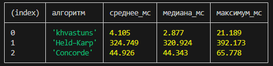

# Атлас · Поиск маршрута

[Открыть приложение на GitHub Pages](https://ge1o1ge.github.io/pathFind/dist/)

«Атлас» показывает, как алгоритм **khvastuns** ищет кратчайший замкнутый маршрут через 3–30 городов. На карте видно, как растут две ветви пути, а на графике — как сближаются длина лучшего маршрута и нижняя граница.

- **Ручной поиск.** Выбери число городов, создай поле и запусти поиск. Его можно поставить на паузу или пройти по шагам.
- **Сбор сложности.** Запускай серии по 1 000 полей, сравнивай число шагов для разных размеров и скачивай сводку в JSON. Завершённые прогоны сохраняются в браузере.

В ручном поиске под графиком нажми **«Сравнить на этом поле»**. Поиск по очереди проверит лимиты 0, 2, 5, 10, 20 и 50 на тех же координатах. Обычный поиск использует максимум **n − 2** разных циклов. Сравнение соблюдает тот же потолок: например, при 30 городах запрос 50 означает 28, а при 12 запросы 10, 20 и 50 дают один замер с лимитом 10. Нулевой лимит полностью отключает разминку.

Время показано отдельно для подготовки, разминки и основного поиска; их сумма не включает отрисовку, паузы, генерацию поля и запись результата. Кандидаты разминки — все проверенные позиции вставки и пары рёбер 2-opt. Проверки жадного старта, принятые циклы и состояния основного поиска считаются отдельно. На графике сохранена прежняя шкала шагов. В статистике и JSON новые показатели усредняются только по прогонам, в которых они измерялись.

Для повторяемого сравнения без браузера запусти `node tools/compare-warmup.cjs 24 30`: это первые 30 полей серии для 24 городов. Скрипт меняет порядок лимитов от поля к полю и выводит средние времена и счётчики. Проверку результатов по независимому точному решателю можно повторить командой `node --test tests/warmup.test.cjs`.

Для локального запуска выполни `python -m http.server 8187 --bind 127.0.0.1 --directory dist` из корня репозитория и открой [локальную страницу](http://127.0.0.1:8187/).

### Сравнение с точными решателями

На первых **200 полях по 20 городов** все три решателя подтвердили одинаковую минимальную длину на каждом поле. При общих целых весах ⌈1000 × расстояние⌉ среднее время на поле составило **4,105 мс** у khvastuns, **324,749 мс** у Held–Karp и **44,926 мс** у Concorde.

Время Concorde в таблице включает запуск процесса и обмен файлами. Его внутренний таймер показал в среднем **6,2 мс** с шагом измерения 10 мс. На отдельной серии из **6 полей по 30 городов** оптимумы тоже совпали, а по полному времени быстрее оказался Concorde — **68 мс** в среднем против **136 мс** у khvastuns.

- **[Held–Karp](https://epubs.siam.org/doi/10.1137/0110015)** — независимый контроль на исходных евклидовых расстояниях. В блоке «Сравнение на одном поле» выбери «khvastuns и Held–Karp» либо запусти `node tools/compare-solvers.cjs 20 12` для первых 12 полей серии. Лимит этой реализации — 22 города из-за памяти.
- **[Concorde](https://www.math.uwaterloo.ca/tsp/concorde/)** — практический эталон для точного решения симметричной задачи коммивояжёра. Передай путь к [консольной сборке](https://www.math.uwaterloo.ca/tsp/concorde/downloads/downloads.htm): `node tools/compare-solvers.cjs 20 12 "C:\путь\concorde.exe"`. На 23–30 городах участвуют khvastuns и Concorde. В этом режиме все получают одну матрицу целых весов ⌈1000 × расстояние⌉. Пересечение в khvastuns отсекается только если оба варианта распутывания дешевле и по целым весам.

В Windows можно положить `concorde.exe` и библиотеку `cygwin1.dll` в папку `concorde` рядом с репозиторием `route-lab`. Чтобы повторить сравнение со скриншота, запусти из `route-lab` команду `node tools/compare-solvers.cjs 20 200 ..\concorde`. Скрипт принимает также путь к родительской папке, если в ней есть такая подпапка `concorde`.

Скрипт меняет порядок решателей от поля к полю, проверяет посещение всех городов и пересчитывает длины по рёбрам. У Concorde выводятся и время вместе с запуском процесса и обменом файлами, и внутреннее время решателя. Сравнения не изменяют статистику браузера.
